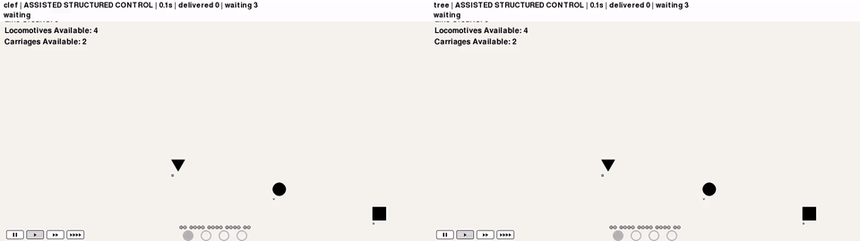
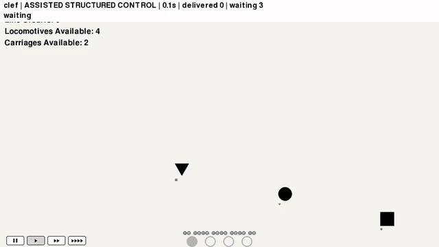

# Metro-Clef

**Can a decision model keep a metro moving? Same simulator, different ways to ask.**


A hackathon experiment in continuous metro management with Cloudflare Clef-flash: compare a flat legal-action menu with a structured decision tree and a separate hand-written heuristic. Built on the MIT-licensed [python_mini_metro simulator](https://github.com/yanfengliu/python_mini_metro), not the commercial game.

## Watch the demo

**Left: choice-menu Clef · Right: tree Clef · Seed 4**



Both policies survived this recording. Choice-menu Clef delivered **24** passengers; tree Clef delivered **27**. This is an illustration, **not a failure-to-success comparison**: the choice-menu game over reported below came from a different run. Clef responses and wall-clock scheduling are not deterministic.

<details>
<summary>Individual demo: choice-menu Clef</summary>



</details>

<details>
<summary>Individual demo: tree Clef</summary>


</details>

## How it works

1. Advance the simulator at fixed **16 ms physics ticks**, with a decision opportunity every **5 simulated seconds**. Simulation continues while inference is pending.
2. Send structured station, queue, route and fleet state to Clef's `/v1/systemone` endpoint. Only one request may be in flight, with a **3-second acceptance deadline**; late or invalid decisions do not trigger a heuristic fallback.
3. Apply a legal atomic route/fleet operation after revalidating it against current state.

**Choice-menu Clef** selects from a flat legal-action menu. **Tree Clef** answers station urgency, fix-type and concrete-action questions in one request; code follows the selected branch. The tree also prunes fleet churn and capacity fixes at stations with nobody waiting. **The pruning is hand-written strategy, not model skill.** Its contribution was not isolated from the question structure.

The heuristic is an independent baseline: connect stations and allocate capacity using explicit rules. All policies have assisted structured control; these are privileged-state visualizations, **not pixel-based or human-equivalent play**.

## Results, without the victory lap

Seeds **1–5**, default demand (900-step spawn interval), **120-second simulated cap**, one run per policy per seed:

| Policy | Mean deliveries | Game overs (out of 5) |
|---|---:|---:|
| Hand-written heuristic | 28.8 | 0 |
| Choice-menu Clef | 22.0 | 2 |
| Tree Clef | 28.8 | 0 |

Tree Clef matched the heuristic's mean deliveries and survival **in this small sample**, but had higher passenger waits. It did not beat the heuristic. No statistical significance or general superiority is claimed. Model latency differs from the near-instant heuristic; no latency-matched baseline was run. Later choice-menu seed-4 recordings survived, so failures are not reliable per seed.

See the [experiment notes and per-seed table](docs/mini-metro-spike.md#decision-tree-clef-tree-vs-choice-menu-clef-vs-heuristic-seeds-1-5-spawn-900-120-s-cap) for timing, rejected experimental variants, provenance and limitations. Earlier sections of those notes are a chronological record, not current setup instructions.

## Run it locally

The metro runner is standalone. **`uv sync` installs the original cooking project, not the metro simulator.** Its `pyproject.toml` still targets Python 3.10–3.11; the metro experiment used a separate Python 3.13 environment. The folder and Python package retain their original names.

Prerequisites: Git, [uv](https://docs.astral.sh/uv/), and Python 3.13 (uv can install it). From a fresh clone:

```sh
git clone https://github.com/akanksh-ch/metro-clef.git
cd metro-clef

# Keep the pinned simulator outside this repository.
git clone https://github.com/yanfengliu/python_mini_metro.git ../python_mini_metro
git -C ../python_mini_metro checkout ef1be2dfdc6e1dadafa9bf2c41d1ce5f081adc4d
uv venv --python 3.13 ../metro-clef-venv
uv pip install --python ../metro-clef-venv/bin/python \
  -r ../python_mini_metro/requirements.txt pillow

# Heuristic: no model service needed.
../metro-clef-venv/bin/python mini_metro_spike.py \
  --upstream ../python_mini_metro --policy heuristic --seed 4 \
  --output runs/local-demo
```

For **Clef**, first provide a compatible, already-running Clef-flash service at `http://127.0.0.1:8080/v1/systemone` (for example, your authorized tunnel). This repository does **not** provision a model server, checkpoint or credentials. With that service available:

```sh
../metro-clef-venv/bin/python mini_metro_spike.py \
  --upstream ../python_mini_metro --policy clef --seed 4 \
  --output runs/local-demo
../metro-clef-venv/bin/python mini_metro_spike.py \
  --upstream ../python_mini_metro --policy tree --seed 4 \
  --output runs/local-demo
../metro-clef-venv/bin/python mini_metro_spike.py \
  --summarize --output runs/local-demo
```

Each run takes roughly two minutes at the default cap. JSON results go under `runs/local-demo/spawn900/`; an existing policy/seed result is not overwritten—use a new output directory to repeat. The runner requires the simulator at the exact pinned commit with no tracked changes. It defaults to headless SDL drivers. Optional `--video` exports MP4/final PNG and additionally requires `ffmpeg` at `/usr/bin/ffmpeg` (the runner's current Linux-specific path). Demo GIFs above are compressed presentation assets, not raw evaluation logs. Simulator dependencies are not fully locked; the experiment notes record tested versions.

## Project map & origins

- [`mini_metro_spike.py`](mini_metro_spike.py): simulator adapter, three policies, asynchronous decision loop and recording.
- [`test_mini_metro_spike.py`](test_mini_metro_spike.py): focused simulator/adapter tests.
- [`docs/mini-metro-spike.md`](docs/mini-metro-spike.md): experimental record and results.
- [`docs/mini-metro-research.md`](docs/mini-metro-research.md): simulator research and provenance.

This began as **overcleffed**, a Clef-driven cooperative cooking experiment. The [original cooking project remains on the `overcleffed` branch](https://github.com/akanksh-ch/metro-clef/tree/overcleffed); its [original quick-start README is preserved here](docs/original-cooking-project.md). No local folder or Python package rename is required.

[Source repository](https://github.com/akanksh-ch/metro-clef) · [License](LICENSE)
